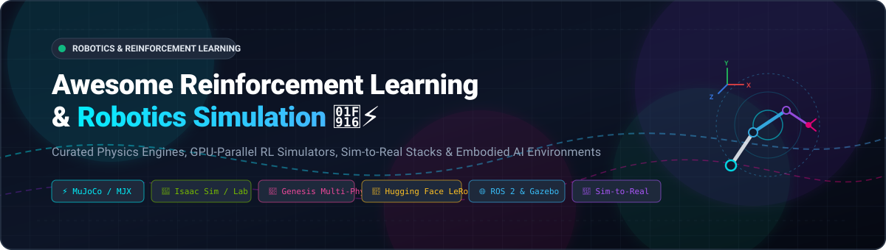

# Awesome Reinforcement Learning &amp; Robotics Simulation 🤖⚡

  

  
  
  
  
  
  
  

---

## 📌 Overview &amp; Ecosystem Scope

A curated directory and reference index of premier **SaaS/hosted platforms** and **open-source physics engines, simulators, and algorithm frameworks** for **Reinforcement Learning (RL), Robotics Simulation, Sim-to-Real Transfer, and Embodied AI**.

These platforms supply high-throughput multi-physics execution, ray-traced sensor modeling, and standardized environment interfaces to train, benchmark, and validate autonomous robot control policies before physical real-world deployment.

> **Key Focus Areas:** Rigid &amp; soft-body dynamics, GPU-parallel batch simulation, Isaac Sim / Lab, MuJoCo / MJX, Gazebo ROS 2 integration, tactile &amp; vision-based manipulation, imitation learning, and foundation models for physical intelligence.

---

## 📑 Table of Contents
- [📊 Sector Overview &amp; Market Dynamics](#-sector-overview--market-dynamics)
- [☁️ SaaS &amp; Commercial Hosted Platforms](#️-saas--commercial-hosted-platforms)
- [🐙 Open-Source GitHub Projects](#-open-source-github-projects)
  - [🏆 Top Repositories Ranked by GitHub_Stars](#-top-repositories-ranked-by-github-stars)
  - [🔬 Recommended Composable Stacks &amp; Framework Selection](#-recommended-composable-stacks--framework-selection)
- [💖 Support &amp; Sponsorship](#-support--sponsorship)
- [📈 Star History](#-star-history)
- [🤝 How to Contribute](#-how-to-contribute)
- [⚖️ Disclaimer &amp; Sim-to-Real Safety](#️-disclaimer--sim-to-real-safety)

---

## 📊 Sector Overview &amp; Market Dynamics

- **Market Size &amp; Growth Trajectory:** The global robotics simulation and digital twin software market is valued at approximately **$0.94 billion to $1.1 billion** (growing at an estimated 14%–16% CAGR toward **$3.2+ billion by 2030**), nested within the broader industrial and autonomous robotics ecosystem exceeding **$54+ billion**.
- **Market Structure &amp; Fragmentation:** The sector is **moderately concentrated at the foundational cloud and proprietary OEM level** (dominated by hyperscalers like AWS, NVIDIA Omniverse, and legacy industrial OEMs like ABB and Siemens), yet **highly fragmented and open-source driven in AI policy learning and research environments** (where modular frameworks like MuJoCo, Genesis, LeRobot, and Gymnasium form the de facto universal standard).

---

## ☁️ SaaS &amp; Commercial Hosted Platforms

The following table indexes leading commercial, managed cloud, and hosted platforms providing scalable GPU infrastructure, digital-twin orchestration, and robotics simulation pipelines. Products are sorted in **descending order by company scale (market capitalization / enterprise valuation)**.

| SaaS / Commercial Platform 🚀 | Company &amp; Valuation / Revenue 🏢 | Core Simulation Focus &amp; Capabilities 🛠️ | Pricing (Starting Tier) 💵 | Free Tier Limits / Trial Plan 🎁 |
| :--- | :--- | :--- | :--- | :--- |
| **[AWS RoboMaker](https://aws.amazon.com/robomaker/)** | **Amazon (AWS)** Valuation: ~$2.1 Trillion | Cloud robotics simulation service for ROS/ROS 2 testing, CI/CD automated regression, and large-scale synthetic world generation. | **$0.40 / SU-hour** ($0.396/Simulation Unit-hr: 1 vCPU, 2 GB RAM); GPU units from $1.485/GU-hr | **25 free SU-hours per month** for the first 12 months under AWS Free Tier. |
| **[NVIDIA Isaac Sim / Omniverse Cloud](https://developer.nvidia.com/isaac)** | **NVIDIA** Valuation: ~$3.4 Trillion | Photorealistic, physically accurate OpenUSD virtual workstation platform for training embodied AI and synthetic sensor generation. | **$2.50 / GPU-hour** on cloud marketplaces (or $4,500/named user/year for NVIDIA Omniverse Enterprise) | **Free local workstation license** for individual developers &amp; researchers; 30-day trial for enterprise. |
| **[Unity Industry / Robotics](https://unity.com/solutions/automotive-transportation-manufacturing)** | **Unity Technologies** Valuation: ~$8.5 Billion | Real-time 3D engine tailored for robotic teleoperation, synthetic vision data creation, and ROS/ROS 2 integration via Unity Robotics Hub. | **$210 / seat / month** ($2,310/yr prepaid for Unity Pro); custom quote for Unity Industry | **Free forever (Unity Personal)** for teams/individuals with revenue under $200,000/yr; 30-day free trial of Pro. |
| **[Viam](https://www.viam.com/)** | **Viam Inc.** Valuation: ~$450 Million (Series B) | Cloud-managed physical AI and robotics platform offering fleet management, real-time telemetry, remote operations, and simulated testbeds. | **$0.005 / machine-hour** for active devices + $0.50/GB cloud data egress/storage | **Free forever tier** with $20 in monthly platform usage credits and free unlimited local development servers. |
| **[CoppeliaSim (Coppelia Robotics)](https://www.coppeliarobotics.com/)** | **Coppelia Robotics** Valuation: ~$15–30 Million (Independent) | Versatile industrial and academic robot simulation platform with multi-physics support (MuJoCo, Bullet, ODE, Vortex) and distributed APIs. | **€1,200 perpetual license** (~$1,300 one-time per seat for CoppeliaSim Pro standalone) | **Free forever (CoppeliaSim Edu)** for non-commercial educational/academic use; 30-day evaluation for commercial teams. |

---

## 🐙 Open-Source GitHub Projects

Robotics simulation and reinforcement learning have an extraordinarily rich open-source culture. Below is a comprehensive list of premier open-source repositories spanning physics engines, GPU training environments, algorithms, benchmark suites, and embodied AI sandboxes.

### 🏆 Top Repositories Ranked by GitHub_Stars

*Sorted in descending order by repository Stars_Count as of November 2026.*

| Repository &amp; Architecture 📦 | Stars_Count 🌟 | Primary Category 🏷️ | Core Highlights &amp; RL Sim-to-Real Utility ⚙️ |
| :--- | :---: | :--- | :--- |
| **[Genesis](https://github.com/Genesis-Embodied-AI/Genesis)** |  | Physics Simulator | Ultra-fast, GPU-accelerated multi-physics engine (rigid body, soft tissue, fluid, cloth) designed for physical AI and generative embodied learning. |
| **[LeRobot](https://github.com/huggingface/lerobot)** |  | Physical AI &amp; Robotics | Hugging Face's open library for real-world robotics and simulation with PyTorch implementations, imitation learning, and teleoperation dataset tools. |
| **[MuJoCo](https://github.com/google-deepmind/mujoco)** |  | Physics Simulator | Google DeepMind's industry-standard contact dynamics physics engine (Apache-2.0); MJX provides hardware-accelerated parallel simulation on JAX/XLA. |
| **[PyBullet](https://github.com/bulletphysics/bullet3)** |  | Physics Simulator | Bullet Physics SDK and PyBullet Python bindings for real-time contact dynamics, robotic arms, quadrupeds, VR, and gym environment training. |
| **[Stable-Baselines3](https://github.com/DLR-RM/stable-baselines3)** |  | RL Algorithms | Reliable PyTorch implementations of model-free reinforcement learning algorithms (PPO, SAC, TD3, A2C, DDPG) standardizing continuous robot control. |
| **[Gymnasium](https://github.com/Farama-Foundation/Gymnasium)** |  | RL Environment API | Universal open API standard for reinforcement learning environments (maintained by Farama Foundation as official successor to OpenAI Gym). |
| **[CleanRL](https://github.com/vwxyzjn/cleanrl)** |  | RL Algorithms | Clean, self-contained single-file implementations of deep RL algorithms with detailed documentation, tensorboard tracking, and minimal boilerplate. |
| **[Isaac Lab](https://github.com/isaac-sim/IsaacLab)** |  | Robot Learning Suite | Modular, high-throughput robot learning framework built on NVIDIA Isaac Sim for GPU-native policy optimization, domain randomization, and sim-to-real transfer. |
| **[DeepMind Lab](https://github.com/deepmind/lab)** |  | Embodied RL Sandbox | First-person 3D game-like research environment built on id Software's Quake III Arena for complex spatial navigation, visual memory, and general RL agents. |
| **[Webots](https://github.com/cyberbotics/webots)** |  | Full Robot Simulator | Turnkey, open-source multi-platform robot simulation software (Apache-2.0) with complete sensor libraries, multi-robot worlds, and native ROS 2 packages. |
| **[DeepMind Control Suite](https://github.com/google-deepmind/dm_control)** |  | Benchmark Envs | Standard continuous-control benchmarks and Python MuJoCo bindings widely cited across reinforcement learning research literature. |
| **[Isaac Sim](https://github.com/isaac-sim/IsaacSim)** |  | Photorealistic Simulator | NVIDIA Omniverse-powered robotics simulation application with RTX ray tracing, ROS/ROS 2 bridges, camera/LiDAR sensors, and synthetic data generation. |
| **[AI Habitat](https://github.com/facebookresearch/habitat-sim)** |  | Embodied AI Simulator | High-performance, photo-realistic 3D simulator for embodied AI agents capable of rendering thousands of indoor navigational steps per second. |
| **[PettingZoo](https://github.com/Farama-Foundation/PettingZoo)** |  | Multi-Agent RL API | Standardized API and environment library for Multi-Agent Reinforcement Learning (MARL), functioning as the multi-agent counterpart to Gymnasium. |
| **[ManiSkill](https://github.com/haosulab/ManiSkill)** |  | Manipulation Benchmark | GPU-parallelized robotics benchmark for generalizable manipulation, featuring realistic contact dynamics, photorealistic rendering, and tactile simulation. |
| **[Project Chrono](https://github.com/projectchrono/chrono)** |  | Multi-Physics Engine | Open-source multi-physics simulation engine specializing in complex vehicle dynamics, granular soil interaction, off-road autonomous systems, and FEA. |
| **[Robosuite](https://github.com/ARISE-Initiative/robosuite)** |  | Robot Learning Suite | Modular simulation suite powered by MuJoCo focused on bimanual robot manipulation, teleoperation collection, and standardized benchmarking. |
| **[AI2-THOR](https://github.com/allenai/ai2thor)** |  | Embodied AI Sandbox | Photorealistic interactive platform for embodied AI by the Allen Institute for AI, providing physics-enabled rooms with actionable household objects. |
| **[OmniGibson](https://github.com/StanfordVL/OmniGibson)** |  | Photorealistic Simulator | Next-generation simulation environment from Stanford built on Omniverse, featuring realistic thermal/fluid states, state changes, and tactile mobile manipulation. |
| **[Gazebo Sim (gz-sim)](https://github.com/gazebosim/gz-sim)** |  | Full Robot Simulator | The official ROS 2 flagship simulation tool suite (formerly Ignition Gazebo), providing flexible multi-engine physics plugins, sensor modeling, and graphical UI. |
| **[SERL](https://github.com/rail-berkeley/serl)** |  | Sim-to-Real / Robot RL | Sample-efficient reinforcement learning suite by UC Berkeley designed for direct training on real hardware and seamlessly transferring policies from simulation. |
| **[iGibson](https://github.com/StanfordVL/iGibson)** |  | Interactive Environment | Fast virtual simulation platform with high-definition real-home scans, interactive articulated objects, and virtual reality support for embodied agents. |

---

### 🔬 Recommended Composable Stacks &amp; Framework Selection

When architecting a production or research pipeline for robotics policy learning, the following component combinations are proven industry best practices:

- 🚀 **Extreme GPU-Parallel Policy Training:** `MuJoCo / MJX` or `Genesis` + `Gymnasium` + `CleanRL / Stable-Baselines3`. Delivers millions of simulated interaction steps per minute on modern GPUs.
- 🦾 **Photorealistic Sim-to-Real &amp; Sensor Synthesis:** `NVIDIA Isaac Sim` + `Isaac Lab` + PyTorch. Provides real-time RTX ray-tracing for LiDAR, depth sensors, RGB cameras, and domain randomization.
- 🤖 **Complete Hardware &amp; ROS 2 System Emulation:** `Gazebo Sim (gz)` or `Webots` paired with `ROS 2 Humble / Iron / Rolling` controllers and Nav2/MoveIt 2.
- 🏠 **Embodied AI &amp; Vision-Language-Action (VLA) Exploration:** `Hugging Face LeRobot` + `AI Habitat` or `OmniGibson` for training multimodal indoor agents.

---

## 💖 Support &amp; Sponsorship

If this curated repository helps your robotics research, sim-to-real transfer projects, or engineering development, please consider showing your support:

- ⭐ **Star this repository** to help others discover it across the robotics and AI community!
- 🍴 **Fork and share** the repo with colleagues, research labs, and teams.
- ☕ **Buy a coffee &amp; support ongoing curation:** You can sponsor our open-source research and ecosystem tracking via the [GitHub Sponsors Dashboard](https://github.com/sponsors/ishandutta2007). Every bit of support is deeply appreciated!

---

## 📈 Star History

## Star History

#

---

## 🤝 How to Contribute

Contributions to expand this list are warmly welcomed! Please adhere to these guidelines:

1. 🍴 **Fork the repository** on GitHub.
2. 📝 **Add or update entries** in `README.md`:
   - Keep descriptions concise, factual, and neutral.
   - For SaaS products, verify and provide exact tier pricing and clear free tier/trial limits.
   - For open-source repositories, ensure proper badge formatting: `` and place it in the star-sorted ranking.
3. 🚀 **Submit a Pull Request** with a descriptive summary of your changes.

---

## ⚖️ Disclaimer &amp; Sim-to-Real Safety

- **Curated Community Index:** This repository is maintained for educational and research reference. Inclusion does not imply official endorsement by any affiliated organization.
- **Sim-to-Real Safety Notice:** Policy performance in physics simulation does not guarantee safe physical robot behavior. Always enforce hardware e-stops, velocity limits, torque clamping, and progressive hardware testing during real-world policy transfer.
- **Licensing:** While most indexed projects are permissively licensed (Apache-2.0, MIT, BSD), certain commercial SDKs and binary distributions have proprietary terms. Always verify license terms for your commercial deployment.

---

  Built with ❤️ for robotics engineers, RL researchers, and physical AI practitioners.

